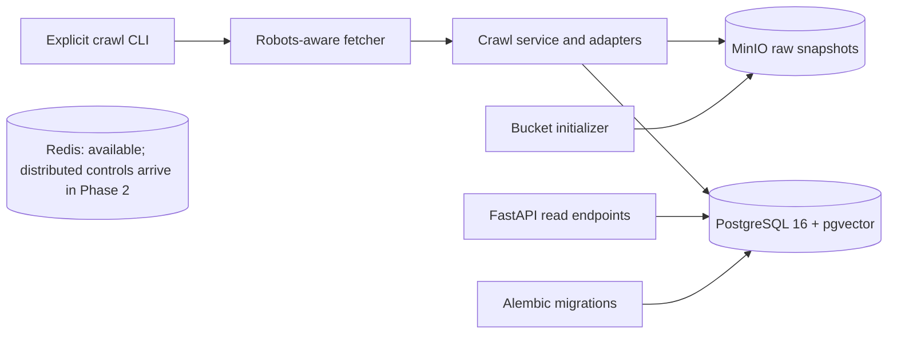

# RegWatch architecture

Phase 1 is complete: infrastructure and migrations, fixture-tested RBI and SEBI
adapters, robots-aware bounded HTTP fetching, immutable raw snapshots, version
deduplication, naive changes, crawl-run auditing and four read endpoints. SEBI was
verified live by an explicit CLI invocation; no automatic scheduler exists. RBI
remains paused and fixtures-only. Meaningful diffs and distributed reliability
are Phase 2 work.

## Decision log

- 2026-11-05: Use Arq for the future worker because its asyncio model fits httpx.
  Celery is a valid alternative but adds machinery this MVP does not need.
  No worker is implemented in Step 1.
- 2026-11-05: Use pgvector's PostgreSQL 16 image and enable its extension now;
  embedding columns and AI behavior remain deferred.
- 2026-11-05: Scope document identity to source and canonical URL; enforce content
  deduplication per document. A change's two version references must belong to
  its document, enforced by composite foreign keys.
- 2026-11-05: Sources default to paused. The supplied robots statement was an
  unfilled placeholder, so RBI access remains unverified and no crawling occurs.
- 2026-11-05: Keep migrations frozen rather than importing current ORM tables
  into historical revisions. This preserves reproducible upgrade history.
- 2026-11-05: Database and Redis are reachable only inside the Compose network;
  MinIO's API and console bind only to the host loopback interface.
- 2026-11-05: Official MinIO image pulls failed from Docker Hub and Quay.
  Build upstream MinIO at release RELEASE.2025-09-07T16-13-09Z and
  its mc client at release RELEASE.2025-08-13T08-35-41Z, rather than switch
  storage products or depend on an unofficial binary mirror. First startup
  requires network access for source and Go dependency downloads.
- 2026-11-06: Use a structural SourceAdapter protocol and frozen Publication
  records. Adapters parse fetched bytes without performing I/O, so future
  sources can share orchestration while retaining source-specific parsers.
- 2026-11-06: Parse RSS with defusedxml, reject DTDs/entities, and cap input at
  2 MiB. Standard ElementTree alone does not express the same explicit XML
  safety policy; HTML parsing is inappropriate for validating an RSS feed.
- 2026-11-06: Reject malformed entries rather than silently skip them, so a
  broken listing cannot masquerade as an empty feed. A missing publication
  date is allowed; a supplied date must be valid and timezone-aware.
- 2026-11-06: Preserve URL query order and path case, strip fragments, normalize
  hostname/default ports, and keep the first duplicate. Query sorting and
  forcing HTTPS are rejected because their equivalence is source-dependent.
  RBI discovery accepts only rbi.org.in and its subdomains; the generic adapter
  contract itself has no regulator-specific host restriction.

- 2026-11-06: Use httpx streaming with explicit connect/read/write/pool timeouts,
  two retries by default, capped exponential backoff, and capped Retry-After
  handling for 429/503. No jitter is implemented in this step.
- 2026-11-06: Delegate path precedence, wildcard matching, and fractional
  Crawl-delay to [Protego](https://pypi.org/project/Protego/0.4.0/).
  A strict UTF-8/directive validation layer pauses on malformed input rather
  than allowing a lenient parser to mistake an HTML error page for permission.
  Reimplementing wildcard/precedence logic or using a less capable parser was
  rejected to keep source-specific crawling code understandable and testable.
- 2026-11-06: Cache successful, missing, and unavailable robots policies for a
  configurable TTL (default 1 hour) in one Fetcher instance. Scope policies by
  scheme/host/port; share request pacing and locks by hostname. Concurrent
  callers share a single policy load. The largest observed Crawl-delay is
  retained for the Fetcher's lifetime, which is deliberately conservative.
  Distributed Redis limits and worker coordination remain Phase 2 work.
- 2026-11-06: Treat robots 404/410 as unrestricted. Treat 401/403, other unexpected
  statuses, exhausted transport/5xx failures, malformed or oversized policies
  as SourcePaused. An empty/comment-only valid file allows access. A caller will
  persist the paused state when crawl orchestration is built; this step only
  returns typed failure outcomes and does not write database state.
- 2026-11-06: Follow redirects manually, with loop and hop limits, checking robots
  for every content destination and retry (refreshing expired cache entries).
  Fetching robots itself and its bounded redirects is the bootstrap exception;
  recursively checking robots before retrieving robots cannot terminate.
  A redirected policy governs the original origin, not the policy server.
- 2026-11-06: Request identity content encoding and count streamed raw bytes,
  with a 10 MiB default response limit and early Content-Length rejection.
  Unexpected content encoding is rejected so compressed payloads cannot bypass
  the memory bound. Streams close on success, retry, and size-limit failure.
- 2026-11-06: Represent the contact address as SecretStr and omit URLs, headers,
  and bodies from result repr and failure messages. Suppress httpx/httpcore
  INFO/debug wire logs that could expose headers or query values. No request
  or response payloads are logged by this layer.

- 2026-11-06: Keep `Accept-Encoding: identity` and reject unexpected compression
  before reading the body. A real-gzip regression test checks zero body reads
  and stream closure. This preserves the existing raw-byte size bound without
  introducing a decompression subsystem in Phase 1.
- 2026-11-06: Hash exact bytes with SHA-256; store objects at `sha256/<digest>`.
  Boto3 conditional PUT (`IfNoneMatch="*"`) prevents overwrites through this
  storage API, including concurrent writers. HEAD-then-PUT was rejected because
  another writer could create the object between those calls. Conditional-write
  semantics were tested against the running MinIO server.
- 2026-11-06: Write object Content-Type plus `content-type`, `byte-size`, and
  `sha256` user metadata. A 412 response reuses the existing object only after
  HEAD verifies consistent metadata and size. The first writer's content type
  remains immutable even if a later response declares another type.
- 2026-11-06: Use the synchronous Boto3 S3 client with explicit connect/read
  timeouts and bounded standard retries. A non-412 error is surfaced as a
  sanitized SnapshotStorageError, including 409 conflicts that a caller may
  retry. Client ownership/closure belongs to the caller. Future async workers
  must offload synchronous storage/SQL calls rather than block the event loop.
- 2026-11-06: Upload before opening a short PostgreSQL transaction, then insert
  the version with ON CONFLICT against `(document_id, content_hash)`. Storage
  failure leaves database state untouched. A later database failure rolls back
  the version but may leave an unreferenced content-addressed object; retries
  safely reuse it. Do not delete objects on rollback: another document may
  already reference the same bytes. There is no cross-system ACID transaction.
- 2026-11-06: record_version requires caller-supplied text/sections and an existing
  document. It does not implement parsing, document discovery, change detection,
  scheduling, or HTTP endpoints. No migration is needed for this step.

- 2026-11-06: Orphan snapshots are safe: they are immutable, content-addressed, and reusable on retry; deleting them on database rollback could remove bytes referenced by another document.

- 2026-11-06: Step 5 adds a crawl service with injected adapters/fetcher/storage
  and a repository for short audit/document transactions. Synchronous SQL/S3
  operations run through asyncio.to_thread; sessions never cross thread calls.
- 2026-11-06: Lock one document row while finding its latest stored version and
  inserting a new version plus naive Change in the same transaction. Relying on
  a version unique constraint alone would not serialize the previous-version
  decision. The first version and duplicate hashes never create Change rows.
  Previously seen hashes count unchanged even after an intervening version;
  the requested unique-content model does not represent reversion occurrences.
- 2026-11-06: Add six nonnegative counters and paused status to crawl_runs through
  migration 0002. Checkpoint discovery and successful fetches before storage,
  then progress after each document. An individual failure is isolated; a
  SourcePaused outcome stops the run, records a fixed reason, and pauses the
  source. Already-paused sources create a paused audit row without HTTP calls.
- 2026-11-06: Keep this step raw-only: normalized_text is empty, sections is [],
  and parser_yield is 0. No HTML/PDF extraction, normalization, or materiality
  claim is made. A naive diff contains from/to hashes and is_cosmetic=false.
- 2026-11-06: Test a real child-process exit immediately after MinIO upload.
  Retrying reuses its orphan object without duplicate versions or changes.
  The abandoned run remains running with last checkpointed counts because
  process termination cannot execute finally; lease expiry/reconciliation is
  deliberately deferred to Phase 2 rather than claiming crash recovery here.

- 2026-11-06: A hard-killed process can leave crawl_runs stuck in running; Phase 2 will add lease expiry and recovery/reconciliation rather than treating those records as completed.

- 2026-11-06: Step 6 exposes only four GET business routes with explicit Pydantic
  schemas. Thin routers delegate to a read repository, which owns SQL projections,
  filters, existence checks, counts, and ordering. Version projections exclude
  normalized_text, sections, and search vectors; no S3 client/body fetch is involved.
- 2026-11-06: Use bounded offset pagination (limit 50 by default, max 100;
  offset 0..100000) and return items/total/limit/offset. UUID tie-breakers make
  equal-timestamp ordering deterministic. Cursor pagination was rejected for
  this MVP's small read API; offset pages are not a snapshot under concurrent writes.
- 2026-11-06: Filter documents by source_id and changes by document_id plus
  inclusive timezone-aware date_from/date_to bounds. Unknown referenced entities
  return 404; malformed IDs, invalid bounds/ranges, and extra parameters return 422.
- 2026-11-06: Create/close the API engine through application lifespan. Each
  repository method owns a short-lived session; synchronous endpoints run off
  the event loop. Bound connect, pool, statement, and lock waits. Database failures
  return a fixed 503; this read layer does not automatically retry queries.
- 2026-11-06: Bind the Compose API to localhost:8000 and wait for successful
  migrations. The API never starts crawls or activates sources. Test the read API
  against real PostgreSQL in unique schemas so empty-result tests do not delete
  or depend on user data. No migration is needed for these read endpoints.

- 2026-11-06: RBI returned 418 for robots.txt; the source is paused rather than guessing; RBI is tested via fixtures.
- 2026-11-06: Preserve the robots HTTP status in cached paused reasons, including retry-exhausted 429 responses. A robots-only fetcher method supports policy inspection without requesting any content page.

- 2026-11-06: SEBI Part 1 captures exact robots.txt bytes and tests that an empty
  Disallow imposes no restriction while the /js, /css, /hindi/js and /hindi/css
  prefixes remain disallowed. Git newline conversion is disabled for this fixture.
  No content page is requested as part of this parser verification.
- 2026-11-06: The user reviewed SEBI's website policy and authorized only a small,
  slow public crawl for private storage. Do not commit full SEBI circulars or PDFs;
  committed content fixtures must be small trimmed samples, accurately reproduced
  and credited to SEBI. Copyright/permission requirements still apply. This is a
  portfolio project, not legal advice.

- 2026-11-06: SEBI discovery parses only the first listing page from saved HTML,
  using table sample_1. Pagination is deliberately omitted: its request contract
  has not been verified and following it would exceed the approved request scope.
  This adapter does not claim complete historical coverage or enable live crawling.
- 2026-11-06: SEBI date-only labels are interpreted as midnight in India and
  converted to UTC; they are approximate publication times. Invalid and duplicate
  rows increment the adapter's most-recent-call skipped_rows diagnostic; a missing
  listing table fails explicitly. The existing adapter interface stays unchanged.
- 2026-11-06: Commit only five SEBI listing metadata rows; full captures stay in
  gitignored local_only and are excluded from Docker build contexts. CI runs the
  deterministic suite with local services, never against regulator sites.

- 2026-11-06: The explicit live CLI supports SEBI with at least five-second
  per-host delays, zero retries and zero redirects. Its request guard allows only
  the approved listing, robots.txt and circular HTML paths on www.sebi.gov.in;
  non-HTML bodies are rejected before download. The CLI stops on document errors,
  while ordinary crawl-service calls retain document-failure isolation. This
  prevents a failed limited verification from making further page requests.

- 2026-11-06: Phase 2 A1 adds standalone Redis token buckets. Atomic Lua uses
  Redis time; normalized hostnames share capacity across processes and ports.
  Capacity defaults to one. Idle expiry occurs only after full natural refill;
  stricter observed rates persist until idle expiry. Client calls have bounded
  timeouts and no automatic retries. Fetcher integration follows in A2.

## Live verification

On 2026-11-06, RBI returned HTTP 418 for robots.txt; it remains paused and
fixtures-only. SEBI was verified live with two circular HTML documents on each
of two runs, using at least 5-second delays, zero retries and no PDF requests.
The first run created two versions; the second created zero new versions and
reported two unchanged documents. No fetched content was committed.

Run IDs: `fcb5a0a6-65ae-431a-bb5e-3252627b4e43` (first) and
`5fdb5410-01ad-4606-b5f0-1af89520e4c5` (repeat).

## Current limits

The storage API now conditionally writes immutable content-addressed objects.
The crawl service orchestrates discovery, fetch, immutable storage, version
deduplication, and naive changes. Parsing/normalization and meaningful diffs
remain unimplemented; run metadata reflects raw-byte processing only.
The four read HTTP endpoints are implemented. No lease scheduler or notifications exist yet. RBI discovery
is tested against synthetic RSS only; compatibility with the live feed remains
unverified. RBI robots returned HTTP 418; RBI remains fixtures-only. Tests inject MockTransport and fake clocks;
the new network tests also run with Docker networking disabled. HTTP destinations
are validated and policy-checked; source enablement and site-terms review remain
manual prerequisites for a future live crawl.
Source validators are reserved fields; document-level validators can be added
with Phase 2 conditional fetching. Parser yield counts extracted sections.

100x scaling analysis will be grounded in later load measurements.
