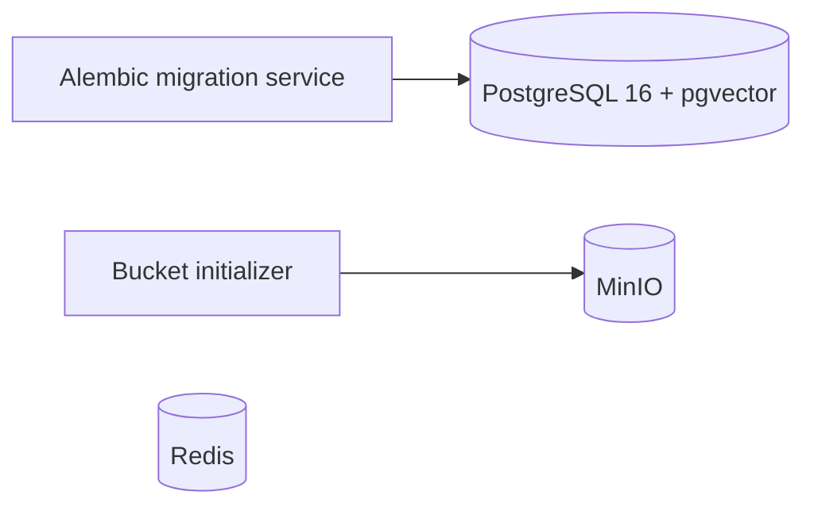

# RegWatch architecture

Phase 1 so far: infrastructure, schema, and fixture-based RBI discovery.

## Decision log

- 2026-11-05: Use Arq for the future worker because its asyncio model fits httpx.
  Celery is a valid alternative but adds machinery this MVP does not need.
  No worker is implemented in Step 1.
- 2026-11-05: Use pgvector's PostgreSQL 16 image and enable its extension now;
  embedding columns and AI behavior remain deferred.
- 2026-11-05: Scope document identity to source and canonical URL; enforce content
  deduplication per document. A change's two version references must belong to
  its document, enforced by composite foreign keys.
- 2026-11-05: Sources default to paused. The supplied robots statement was an
  unfilled placeholder, so RBI access remains unverified and no crawling occurs.
- 2026-11-05: Keep migrations frozen rather than importing current ORM tables
  into historical revisions. This preserves reproducible upgrade history.
- 2026-11-05: Database and Redis are reachable only inside the Compose network;
  MinIO's API and console bind only to the host loopback interface.
- 2026-11-05: Official MinIO image pulls failed from Docker Hub and Quay.
  Build upstream MinIO at release RELEASE.2025-09-07T16-13-09Z and
  its mc client at release RELEASE.2025-08-13T08-35-41Z, rather than switch
  storage products or depend on an unofficial binary mirror. First startup
  requires network access for source and Go dependency downloads.
- 2026-11-06: Use a structural SourceAdapter protocol and frozen Publication
  records. Adapters parse fetched bytes without performing I/O, so future
  sources can share orchestration while retaining source-specific parsers.
- 2026-11-06: Parse RSS with defusedxml, reject DTDs/entities, and cap input at
  2 MiB. Standard ElementTree alone does not express the same explicit XML
  safety policy; HTML parsing is inappropriate for validating an RSS feed.
- 2026-11-06: Reject malformed entries rather than silently skip them, so a
  broken listing cannot masquerade as an empty feed. A missing publication
  date is allowed; a supplied date must be valid and timezone-aware.
- 2026-11-06: Preserve URL query order and path case, strip fragments, normalize
  hostname/default ports, and keep the first duplicate. Query sorting and
  forcing HTTPS are rejected because their equivalence is source-dependent.
  RBI discovery accepts only rbi.org.in and its subdomains; the generic adapter
  contract itself has no regulator-specific host restriction.

## Current limits

Version rows contain references to snapshots; application-enforced immutable
uploads and content addressing will arrive with the crawl/storage step. This
infrastructure alone does not establish an immutable snapshot pipeline.
No lease scheduler, fetcher, HTTP API, or notifications exist yet. RBI discovery
is tested against synthetic RSS only; compatibility with the live feed remains
unverified. No RBI network requests occur in adapter code or tests. The future
fetcher must separately enforce robots policies and validate redirect hosts.
Source validators are reserved fields; document-level validators can be added
when fetching behavior is implemented. Parser yield counts extracted sections.

100x scaling analysis will be grounded in later load measurements.
