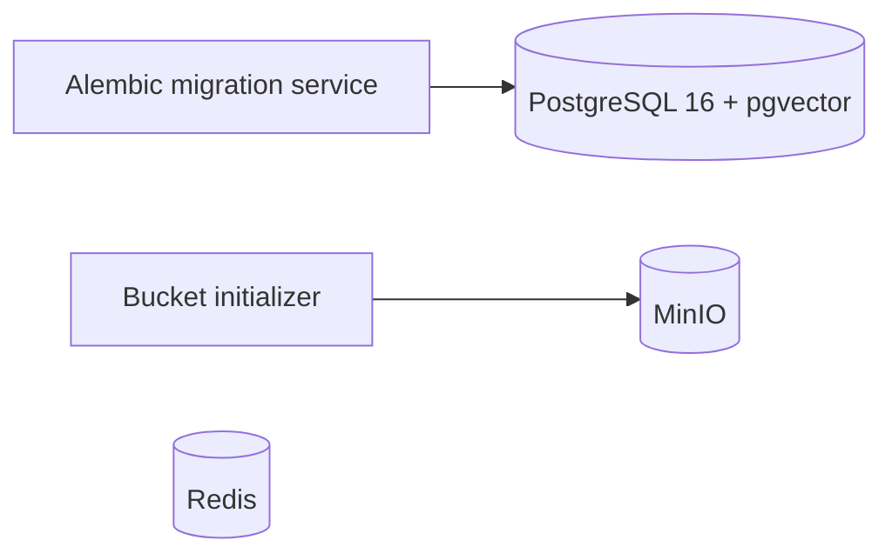

# RegWatch architecture

Step 1 only: database, queue infrastructure, object storage, and migrations.

## Decision log

- 2026-11-05: Use Arq for the future worker because its asyncio model fits httpx.
  Celery is a valid alternative but adds machinery this MVP does not need.
  No worker is implemented in Step 1.
- 2026-11-05: Use pgvector's PostgreSQL 16 image and enable its extension now;
  embedding columns and AI behavior remain deferred.
- 2026-11-05: Scope document identity to source and canonical URL; enforce content
  deduplication per document. A change's two version references must belong to
  its document, enforced by composite foreign keys.
- 2026-11-05: Sources default to paused. The supplied robots statement was an
  unfilled placeholder, so RBI access remains unverified and no crawling occurs.
- 2026-11-05: Keep migrations frozen rather than importing current ORM tables
  into historical revisions. This preserves reproducible upgrade history.
- 2026-11-05: Database and Redis are reachable only inside the Compose network;
  MinIO's API and console bind only to the host loopback interface.
- 2026-11-05: Official MinIO image pulls failed from Docker Hub and Quay.
  Build upstream MinIO at release RELEASE.2025-09-07T16-13-09Z and
  its mc client at release RELEASE.2025-08-13T08-35-41Z, rather than switch
  storage products or depend on an unofficial binary mirror. First startup
  requires network access for source and Go dependency downloads.

## Current limits

Version rows contain references to snapshots; application-enforced immutable
uploads and content addressing will arrive with the crawl/storage step. This
infrastructure alone does not establish an immutable snapshot pipeline.
No lease scheduler, fetcher, adapter, HTTP API, or notifications exist yet.
Source validators are reserved fields; document-level validators can be added
when fetching behavior is implemented. Parser yield counts extracted sections.

100x scaling analysis will be grounded in later load measurements.
